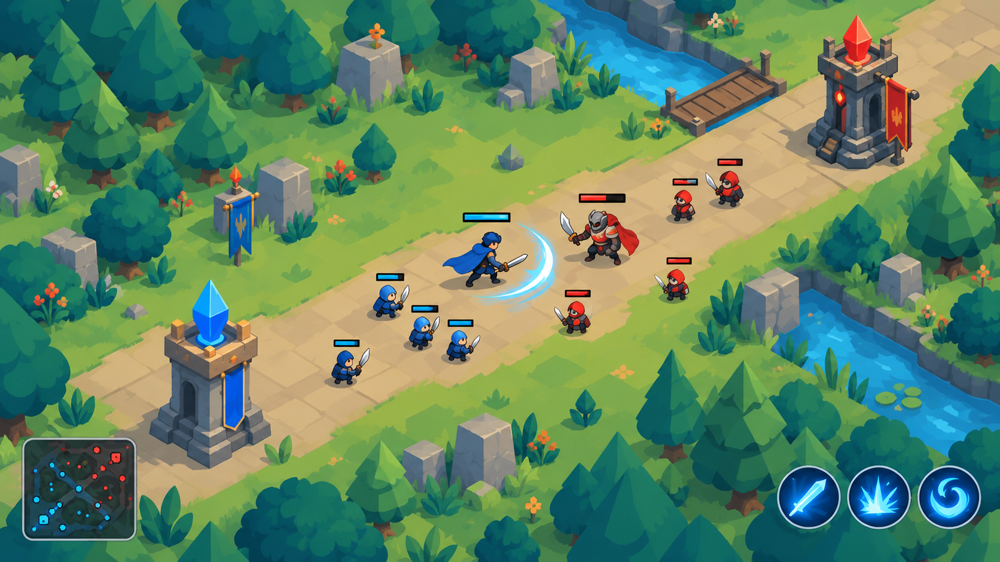

# Đồ họa, hoạt ảnh, giao diện

> Trạng thái: **ĐÃ CHỐT** phong cách (D-25, D-28); ảnh duyệt theo đợt trong `art_inbox/YEU_CAU_ANH.md`.

## Nguyên tắc

1. **Lối chơi trước, hình đẹp sau, nhưng chỗ cho hình phải có từ đầu.** Mỗi hero,
   skill, hiệu ứng, món đồ đều khai báo sẵn id hình ảnh ngay từ M0. Lúc đầu id đó
   trỏ tới hình tạm; khi có hình thật chỉ cần thay file, không sửa code.
2. **Hình chỉ đọc trạng thái mô phỏng.** Hoạt ảnh chạy **theo** mốc thời gian của
   SIM (vung tay đánh CMB-06, thời gian tung chiêu ABL-03), không bao giờ ngược lại.
   Vì vậy đổi hình không làm lệch cân bằng, và test không cần hình.
3. **Thiếu hình thì hiện hình tạm, không bao giờ lỗi.** Mọi tra cứu hình đi qua một
   chỗ (`ArtLibrary`), không có đường dẫn file nào nằm trong SIM hay trong content.
4. **Đọc được trên điện thoại là trên hết.** Trong 0.5 s người chơi phải nhận ra: ai
   là ai, phe nào, đang bị hiệu ứng gì, skill sắp rơi ở đâu.
5. Không làm hình thật cho thứ mà lối chơi còn đang đổi. Hình thật của một hero chỉ
   bắt đầu khi bộ skill của hero đó đã chơi thử và chốt.

## Phong cách (chốt theo ảnh mẫu `docs/art/reference_style_01.png`)



- **Góc nhìn 3/4 nghiêng từ trên xuống** (như Liên Quân, Brawl Stars). Logic trận đấu
  vẫn 2D phẳng; chỉ phần vẽ có "chiều cao":
  - mặt đất (cỏ, đường lane lát đá, sông, nền base) vẽ phẳng;
  - cây, đá, trụ, cờ, nhân vật là **hình đứng**, gốc đặt ở chân, có bóng mềm dưới chân;
  - vẽ theo thứ tự trục Y (cái ở thấp hơn trên màn hình đè lên cái ở cao hơn), bật
    `y_sort_enabled` trong Godot.
- **Nhân vật chibi**: đầu to, dáng lùn, nét viền tối dày, màu bão hòa, đổ bóng 2–3 tông
  phẳng. Lính nhỏ hơn hero rõ rệt. Phe thể hiện bằng màu áo/mũ chủ đạo (xanh / đỏ)
  cộng thanh máu xanh / đỏ trên đầu.
- **Trụ**: tháp đá có pha lê trên đỉnh và cờ phe (pha lê xanh dương / đỏ).
- **Map giữ nguyên bố cục hiện tại** (`tools/map_build`), chỉ đổi cách vẽ:
  - vùng rừng → rải cây lá kim và cây tròn nhiều cỡ, mọc kín vùng chặn, có thứ tự
    theo Y để nhân vật đi sau cây bị che một phần;
  - vách đá → khối đá xám xếp thành tường;
  - lane → đường lát đá vàng nâu, viền cỏ;
  - sông → nước xanh có bờ đá, cầu gỗ ở các chỗ lane băng qua;
  - trang trí không chặn đường: bụi cỏ, hoa, đá nhỏ, cờ.
  Vị trí rải cây tính từ polygon rừng với seed cố định, nên **cây vẽ ra luôn nằm
  trong vùng va chạm** (MAP-01 vẫn đúng).
- Giao diện như ảnh: minimap khung bo tròn ở góc dưới trái, nút skill tròn có viền
  phát sáng ở góc dưới phải, thanh máu nhỏ gọn trên đầu.
- Màu phe: Blue `#3D8BFF`, Red `#FF4D4D`. Nền cỏ xanh sáng, rừng xanh đậm hơn để nhân
  vật và hiệu ứng luôn nổi lên trên.

## Nguồn hình ảnh

Chất lượng như ảnh mẫu là **tranh vẽ raster (PNG)**, không phải hình vector tự sinh.
Có ba nguồn, có thể kết hợp:

| Nguồn | Ưu | Nhược |
|---|---|---|
| Bộ asset mua sẵn (isometric/top-down fantasy, chibi) | Nhanh, đồng bộ, rẻ | Hero khó độc nhất; phải kiểm tra giấy phép |
| Công cụ tạo ảnh AI + chỉnh tay | Ra đúng ý tưởng nhanh | Khó giữ nhân vật giống nhau qua các khung hoạt ảnh; cần dọn nền, cắt mảnh |
| Họa sĩ | Đẹp, độc nhất, đúng hợp đồng hoạt ảnh | Chi phí, thời gian |

Đề xuất: map, trang trí, lính, trụ lấy từ bộ asset; 4 hero và icon skill dùng tạo
ảnh AI để chốt ý tưởng, sau đó họa sĩ hoặc tự chỉnh thành bộ mảnh ghép để làm hoạt
ảnh. Tôi (AI) làm: đường ống hình ảnh, hình tạm đúng góc nhìn và tỉ lệ, rải cây theo
polygon, hiệu ứng hạt và shader, giao diện, nhập và cắt asset.

## Phiếu yêu cầu ảnh

Danh sách ảnh cụ thể (tên file, kích thước, câu mô tả, thứ tự đợt, điểm dừng chờ
duyệt) nằm ở **`art_inbox/YEU_CAU_ANH.md`** — đó là phiếu việc cho công cụ tạo ảnh
(Codex…), không phải tài liệu luật. Mục dưới đây là quy cách gốc để soạn phiếu đó.

**Hoạt ảnh (D-157, trận 3D):** tướng và lính là nhân vật 3D có xương (KayKit, `assets/models/units_3d.json`):
hoạt ảnh đứng / chạy / đánh / tung chiêu / lướt / trúng đòn / ngã lấy từ bộ hoạt ảnh dùng chung của rig.
Ảnh 2D của tướng / lính vẫn dùng cho chân dung, nút, minimap; đơn vị chưa có mô hình (quái rừng, công trình)
hiện bằng ảnh đứng quay về camera.

## Quy cách asset cần lấy (gửi cho công cụ AI, họa sĩ, hoặc dùng khi chọn bộ asset)

### Quy cách chung

- **PNG nền trong suốt**, không viền trắng quanh nhân vật, không bóng đổ vẽ sẵn dưới
  chân (game tự thêm bóng). Nếu bóng dính sẵn thì phải là lớp riêng.
- **Góc nhìn 3/4** từ trên xuống (camera nghiêng khoảng 45–55°), giống ảnh mẫu.
  **Ánh sáng từ trên–trái.** Nét viền tối, màu bão hòa, đổ bóng phẳng 2–3 tông.
- **Vẽ to gấp đôi kích thước hiển thị**, game tự thu nhỏ:

| Loại | Khung ảnh | Vật thể chiếm |
|---|---|---|
| Hero | 512 × 512 | cao ~360 px, chân ở 1/5 dưới khung |
| Lính, quái nhỏ | 256 × 256 | cao ~170 px |
| Quái lớn, boss | 512 × 512 | cao ~380 px |
| Trụ, nhà chính | 512 × 768 | đế rộng ~300 px |
| Cây | 256–512 vuông | nhiều cỡ |
| Ô nền lặp (cỏ, đường, nước) | 512 × 512 | phải ghép liền không thấy mối nối |
| Icon skill, đồ | 256 × 256 | |
| Icon trạng thái | 64 × 64 | |
| Chân dung hero | 512 × 512 | |

- **Đặt tên** theo id: `hero_brakk_body.png`, `skill_noctis_w.png`, `item_ghost_scepter.png`,
  `env_tree_pine_02.png`. Chép hình thô vào thư mục `art_inbox/` của dự án; tôi cắt,
  đổi tên, nhập vào `assets/` và gắn vào ArtLibrary.
- Giấy phép: chỉ dùng asset cho phép **dùng thương mại** trong game; lưu file giấy phép
  vào `assets/licenses/`.

### Danh sách theo thứ tự ưu tiên

**1. Môi trường** (nên dùng bộ asset mua sẵn; ảnh hưởng toàn bộ màn hình từ sớm)
- Ô nền lặp: cỏ (2–3 biến thể), đường lát đá + viền, nền base (viền xanh / đỏ), nước sông + bờ đá.
- Cây lá kim và cây tròn: mỗi loại 3 cỡ × 2–3 biến thể. Bụi, hoa, đá nhỏ: 10–20 món trang trí.
- Tường đá (vách) dạng mảnh ghép: đoạn thẳng, góc, đầu mút. Cầu gỗ.
- Trụ T1–T3 và trụ T4 (xanh / đỏ) + hình bị phá; nhà chính (2 màu); fountain (2 màu); cờ phe.

**2. Đơn vị phụ** (bộ asset hoặc AI)
- Lính cận chiến, đánh xa, công thành — mỗi loại 2 màu; hoạt ảnh: đứng, đi, đánh, chết
  (sprite sheet 6–8 khung là đủ cho lính).
- Quái rừng 4 loại: nhỏ, vừa, lớn, boss. Con ếch (hình HEXED, dùng chung).

**3. Bốn hero** (AI để chốt ý tưởng, sau đó cắt mảnh)
- Bước 1 — **bảng nhân vật**: mỗi hero 1 ảnh mặt trước 3/4 + mặt sau, cùng phong cách ảnh mẫu.
  Duyệt xong mới làm bước 2.
- Bước 2 — **mảnh ghép** (từng PNG riêng hoặc 1 file PSD nhiều lớp): đầu, thân, cánh tay
  trên/dưới trái và phải, bàn tay, đùi/cẳng chân trái và phải, vũ khí, áo choàng/phụ kiện.
  Các mảnh vẽ ở tư thế đứng thẳng, chỗ khớp nối có phần chồng lên nhau để khi xoay không hở.
- Chân dung 512 × 512 cho mỗi hero.

| Hero | Mô tả cho người vẽ / công cụ AI |
|---|---|
| Brakk · Thiết Quyền | Chiến binh to lớn, giáp sắt nặng, găng tay sắt khổng lồ, không cầm vũ khí, tông xám thép + cam |
| Myra · Pháp sư | Nữ pháp sư nhỏ nhắn, áo choàng dài, gậy phép đầu pha lê băng, tông xanh băng + trắng |
| Noctis · Sát Ảnh | Sát thủ trùm mũ, khăn che mặt, hai dao găm, áo choàng rách, tông tím đen + xanh ngọc |
| Vexa · Phù Thủy | Phù thủy trẻ, mũ chóp nhọn, sách phép bay bên cạnh, tông xanh lục + tím, có ếch nhỏ trên vai |

**4. Icon** (AI làm tốt nhất)
- 4 nội tại + 12 skill + 9 đồ (256 × 256, khung tròn viền sáng như ảnh mẫu).
  Talent dùng lại icon skill kèm dấu "II".
- 13 icon trạng thái 64 × 64 (bảng "Hình cho từng trạng thái" ở trên).

**5. Giao diện**
- Nút tròn (skill, đánh), khung minimap bo tròn, joystick (đế + núm), khung thanh máu,
  bảng shop, nút bấm thường. Kiểu: viền đá/kim loại tối, phát sáng xanh như ảnh mẫu.
- Phông chữ có hỗ trợ tiếng Việt đầy đủ dấu (ví dụ Baloo 2, Nunito — kiểm tra giấy phép).

**6. Ảnh nền cho hiệu ứng** (hầu hết hiệu ứng tôi làm bằng hạt và shader trong Godot)
- 8–12 ảnh **trắng/xám trên nền trong suốt** để tô màu trong game: vệt chém hình
  vòng cung, vòng sáng, tia lấp lánh, khói, mảnh băng, vòng phép (dùng báo trước vùng
  skill), tia sét, ngọn lửa nhỏ.

### Mẫu câu lệnh cho công cụ tạo ảnh AI

Luôn đính kèm ảnh mẫu `docs/art/reference_style_01.png` làm tham chiếu phong cách, rồi:

```
[mô tả nhân vật/vật thể], chibi stylized game asset, 3/4 top-down view,
bold dark outlines, flat cel shading with 2-3 tones, saturated colors,
lighting from top-left, full body, centered, standing pose,
transparent background, no ground shadow, no text, single character
```

Với icon: `round game skill icon, [mô tả], glowing [màu] rim, dark background,
high contrast, readable at small size, same style as reference`.

Mẹo giữ nhân vật giống nhau giữa các ảnh: tạo bảng nhân vật trước, sau đó luôn đính
kèm bảng đó làm tham chiếu nhân vật; dùng công cụ cho phép huấn luyện hoặc khóa phong
cách theo bộ ảnh của mình nếu có.

## Hợp đồng hình ảnh (thứ code cần, hình phải cung cấp)

| Đối tượng | Cần có | Ghi chú |
|---|---|---|
| Hero | Scene view với hoạt ảnh: `idle`, `run`, `attack` (có khung "nhả đòn" khớp `attack_point`), `cast_q`, `cast_w`, `cast_r` (khớp `cast_time`), `hit`, `death`, `respawn`; dạng thay thế khi HEXED | Một scene cho mỗi hero |
| Chân dung hero | 512 × 512 vuông, 128 × 128 tròn (HUD) | PNG |
| Icon skill, talent, đồ | 256 × 256 | PNG, cùng khung viền theo loại |
| Skill | Hình lúc tung, đạn bay, vùng báo trước (telegraph) cho vùng có độ trễ, hình lúc trúng | Vùng báo trước bắt buộc với ABL-06 |
| Hiệu ứng (EffectDef) | `vfx` trên đơn vị + `status_icon` trên thanh máu | Bảng dưới |
| Lính, trụ, nhà chính, quái rừng | `idle`, `attack`, `death` | Trụ: hình bị phá |

### Hình cho từng trạng thái (phải phân biệt được ngay)

| State | Trên đơn vị | Icon thanh máu |
|---|---|---|
| STUNNED | Vòng sao quay trên đầu | sao |
| ROOTED | Xích/dây leo dưới chân | xích |
| SILENCED | Dấu môi gạch tím trên đầu | môi gạch |
| DISARMED | Hai kiếm bắt chéo đỏ | kiếm chéo |
| Làm chậm | Phủ xanh nhạt, hạt băng | bông tuyết |
| INVISIBLE | Phe mình: mờ 40% + gợn sóng. Phe địch: **không thấy gì** | — |
| REVEALED | Biểu tượng con mắt | mắt |
| GHOST | Xanh lục trong suốt 50% | hồn ma |
| UNTARGETABLE | Vệt mờ chuyển động (lúc lướt) | — |
| INVULNERABLE | Viền trắng vàng sáng; Gậy Lốc Xoáy: lốc xoáy cuốn quanh | khiên vàng |
| MAGIC_IMMUNE | Hào quang vàng dày quanh người | khiên phép |
| HEXED | Thay hẳn bằng hình con ếch | ếch |
| Khiên | Bong bóng bao quanh + vạch trắng nối thêm vào thanh máu | — |

## Cách làm hoạt ảnh

Hai cách, chọn theo nguồn hình của từng hero:

- **Cắt ghép (cutout):** hero là các mảnh PNG (đầu, thân, tay, chân, vũ khí, áo choàng)
  gắn vào `Skeleton2D` / `AnimationPlayer`. Ít hình phải vẽ, chuyển động mượt, một bộ
  xương dùng lại cho nhiều hero. Hợp với phong cách chibi trong ảnh mẫu. **Đề xuất mặc định.**
- **Sprite sheet:** mỗi hoạt ảnh là chuỗi khung vẽ sẵn, 4–8 hướng. Đẹp nếu họa sĩ vẽ
  đủ, nhưng tốn hình và bộ nhớ trên điện thoại.

Với góc 3/4, hero cần ít nhất 2 hướng (sang trái/phải bằng lật hình) ở bản đầu; thêm
hướng lên/xuống khi có họa sĩ.

Nhờ hợp đồng hình ảnh, hình tạm thay bằng hình thật lúc nào cũng được mà không đụng code.

## Giao diện trên điện thoại

- Trái: joystick. Phải: nút đánh lớn, xung quanh là Q, W, R theo hình vòng cung,
  phía trên là các ô đồ chủ động. Trên cùng: thời gian, tỉ số. Góc: minimap.
- Kéo nút skill để ngắm (hướng hoặc điểm), thả để dùng, kéo ra vùng hủy để hủy.
- Nút skill hiện: hồi chiêu (quạt tối dần + số giây), thiếu mana (xanh xám), bị
  SILENCED/HEXED (khóa).
- Kích thước chạm tối thiểu 88 px ở độ phân giải 1080p.

## Lộ trình đồ họa (chạy song song, xem ROADMAP mục "Đồ họa")

| Mốc | Nội dung | Bắt đầu khi |
|---|---|---|
| A0 | Góc nhìn 3/4, y-sort, bóng dưới chân; bộ hình tạm đúng tỉ lệ (hero, lính, trụ); ArtLibrary; rải cây/đá theo polygon map bằng hình tạm | Cùng M1 |
| A1 | Hình cho trạng thái (bảng trên) + icon thanh máu | Theo từng state, M3–M6 |
| A2 | Vùng báo trước, đạn, hiệu ứng trúng của skill | Theo từng hero, M3–M6 |
| A3a | Hero thật dạng ảnh thân đơn + hoạt ảnh do code, chân dung, icon skill | Sau khi bộ skill hero đó đã chốt |
| A3b | Nâng hoạt ảnh hero lên cắt ghép nhiều mảnh / khung hình | Khi có họa sĩ |
| A4 | Giao diện hoàn chỉnh, icon đồ, màn chọn hero, shop | Cùng M8 |
| A5 | Thay map và trang trí bằng asset thật, âm thanh, rung màn hình, số sát thương | Sau M8 (có thể sớm hơn nếu đã mua bộ asset) |
